# Implicit state machines — SLNews

Generated 2026-11-12 from the current repositories. These are **implicit**
machines: behaviour that is encoded in booleans, nullable fields, timers and
provider lifecycles instead of an explicit `enum`/sealed state type.

Scope:

- `SLNews-App` — Flutter app (`com.slnews.mobile`, code 50)
- `SLNews-Web` — Next.js admin/API (`a9e24af` line)
- `SLNewsAPIScapper` — Express scraper

How to view: open this file in GitHub, VS Code Markdown Preview, or any Mermaid
renderer (VS Code: “Markdown Preview Mermaid Support”). Each diagram is paired
with the variables that actually hold the state.

---

## 0. Overview — how the machines couple

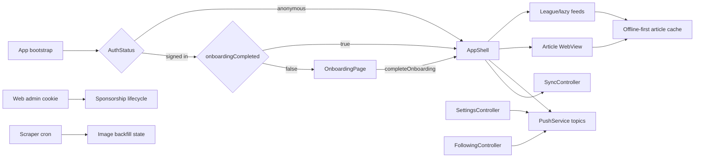

The risky couplings are:

1. **Auth → onboarding → shell** (three independent async sources).
2. **Following/settings → FCM topic set** (desired vs applied set).
3. **Offline flag → WebView / feed fallback** (no explicit retry state).
4. **Admin cookie → campaign lifecycle** (orthogonal auth and time windows).

---

## 1. App session gate (auth × onboarding)

**Files:** `lib/core/shell/app_shell.dart:36-53`,
`lib/core/providers/auth_providers.dart:65-110`,
`lib/core/domain/auth/auth_repository.dart`.

**State holders:** `AuthStatus {unknown, signedOut, signedIn}`,
`AuthState.user`, `AppSettings.onboardingCompleted`.

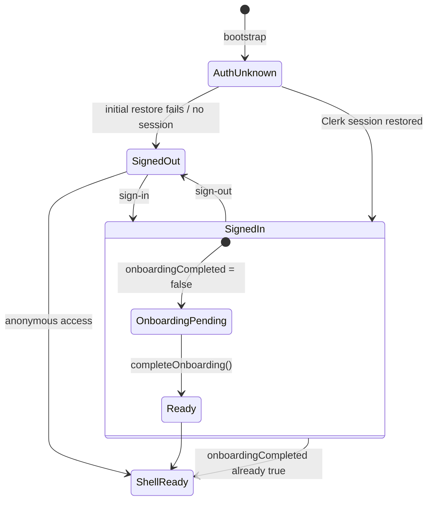

| From | Event | Guard | Effect |
|---|---|---|---|
| boot | auth state emitted | — | shell renders with `isSignedIn = false` |
| signed-out | sign-in | Clerk session created | `AuthState` updated; gate re-evaluates |
| signed-in | gate build | `!onboardingCompleted` | returns `OnboardingPage`, shell hidden |
| signed-in | `completeOnboarding()` | — | persisted pref, gate returns shell |
| signed-in | sign-out | — | shell returns, onboarding flag kept |

**Implicit hazards**

- `AuthStatus.unknown` is treated as *not signed in* by the gate, so the shell
  can render for one or more frames before a restored session lands.
- `AuthState.isSignedIn` requires `status == signedIn && user != null`;
  `ClerkAuthRepository.status` only checks `_state.isSignedIn`. A transient
  “signed in but no user” combination renders anonymous even though auth says
  signed in.
- Onboarding only applies to signed-in users. Anonymous first-run users never
  get the topic/city picker.

---

## 2. Onboarding completion machine

**File:** `lib/features/onboarding/presentation/onboarding_page.dart:169-198`.

**State holders:** `_topics`, `_locationId`, `_saving`, persisted
`settings.onboardingCompleted`.

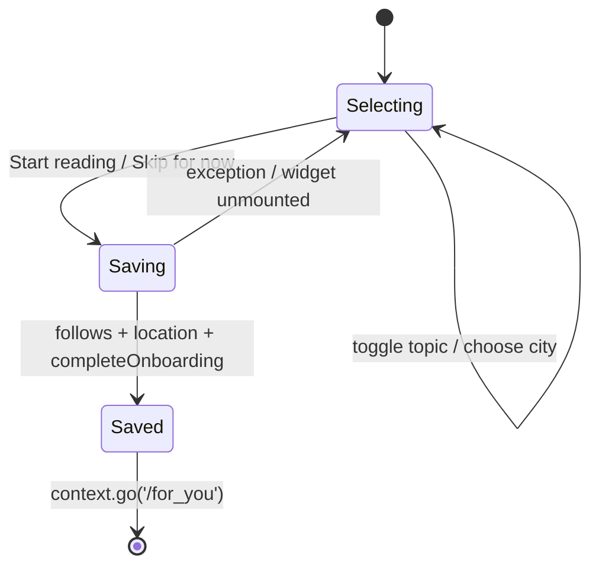

| State | Entered by | Exit |
|---|---|---|
| `Selecting` | first render | `_finish(skip: false/true)` |
| `Saving` | `_saving = true` | all writes finish |
| `Saved` | `completeOnboarding()` | navigation |
| rollback | exception in `try` | `finally` resets `_saving` |

**Hazards**

- No `catch`: a failed follow/location write leaves the user on the picker with
  no error message; `_saving` resets in `finally`.
- Partial writes are possible (some follows persisted, onboarding not marked).
- `skip: true` still calls `completeOnboarding()` and navigates.

---

## 3. Push registration + FCM topic segmentation

**File:** `lib/core/push/push_service.dart`; callers:
`controllers.dart` (`SettingsController._syncPushSegments`),
`app.dart` (startup sync), `FollowingController.toggle`.

**State holders:** OS permission status, `_activeTopics`, `_testMode`,
Firebase initialization, token registration.

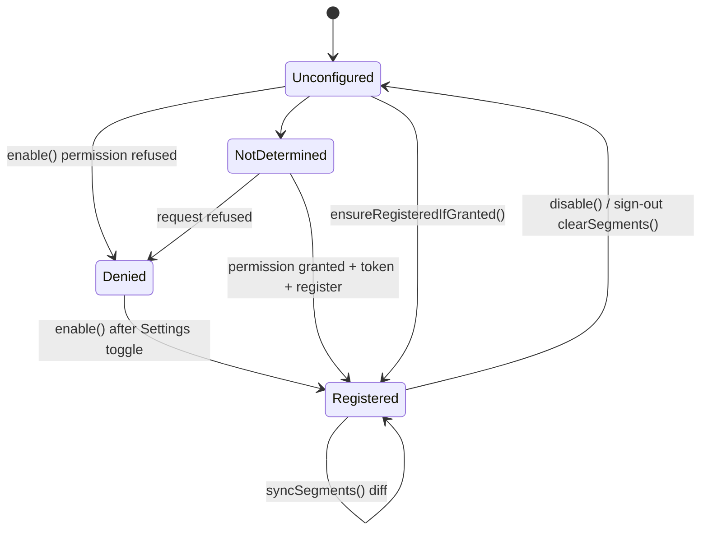

Topic sync is a second machine:

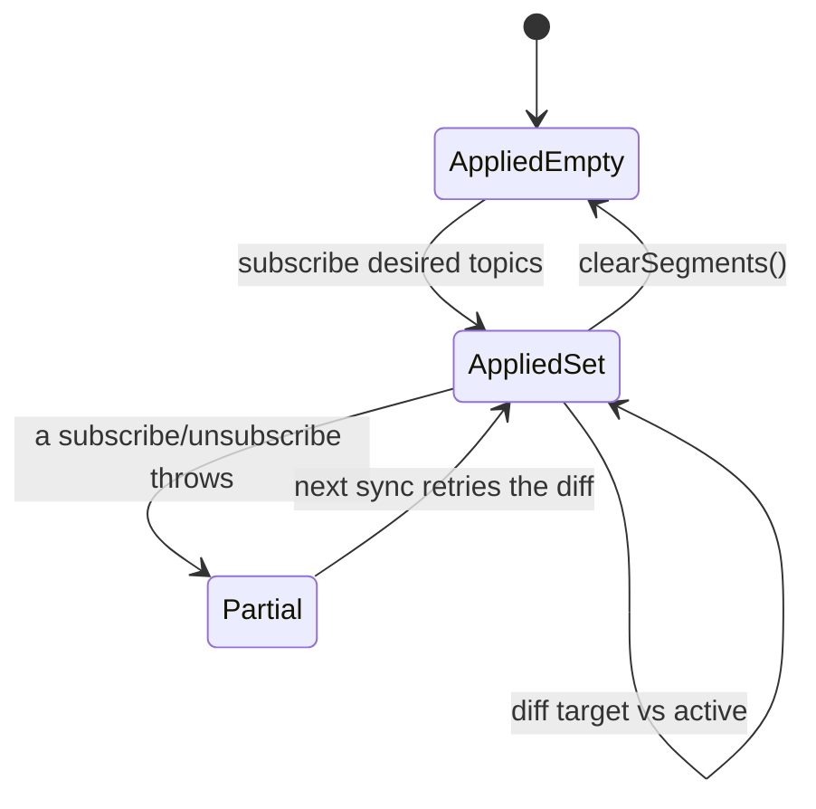

| Desired set | Computed from |
|---|---|
| `slnews_breaking` | `breakingNewsAlertsEnabled` |
| `slnews_sports` | `sportsAlertsEnabled` |
| `slnews_topic_<id>` | followed topics + `followedTopicAlertsEnabled` |
| team topics | `followingControllerProvider.followedIds` |

**Hazards**

- `_activeTopics` is in-memory only: after process restart the SDK topic set and
  `_activeTopics` agree only because the app re-derives and re-subscribes.
- Subscribe/unsubscribe errors are swallowed; the next `syncSegments` retries,
  but there is no persisted “applied” set or backoff.
- `disable()` clears segments and unregisters the token; if sign-out ordering
  changes, a stale registration can survive.

---

## 4. Sync machine

**File:** `lib/core/providers/sync_controller.dart:26-220`;
repository contract `lib/core/domain/sync/sync_repository.dart`.

**State holders:** `SyncStatus.phase {disabled, idle, syncing, synced, failed}`,
`_debounce` (3 s), `_lastPushedAt`, ledger.

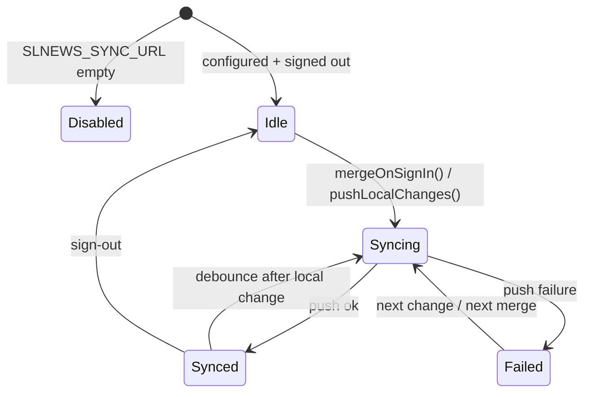

| Trigger | Method | Notes |
|---|---|---|
| app/sign-in | `mergeOnSignIn` | push local → pull → LWW merge → apply |
| bookmark/like/follow | `schedulePush` | 3 s coalescing timer |
| timer fire | `pushLocalChanges` | delta since `_lastPushedAt` |
| sign-out | not explicit here | depends on caller |

**Hazards**

- No retry/backoff on failure: `Failed` persists until another local change or a
  future `mergeOnSignIn`. Killing the app during the 3 s debounce loses the push
  (the ledger will later include the change, but only on the next trigger).
- `recordLocalChange` awaits the ledger then schedules; if ledger write fails,
  the local change may sync with a wrong timestamp.
- `mergeOnSignIn` repeatedly run is idempotent only through server LWW.

---

## 5. Article WebView reader

**File:** `lib/features/article/presentation/article_web_page.dart:79-280`.

**State holders:** `_controller`, `_loading`, `_failed`, `_progress`,
`_attempt`, plus `OfflineStatus` and whether a source URL exists.

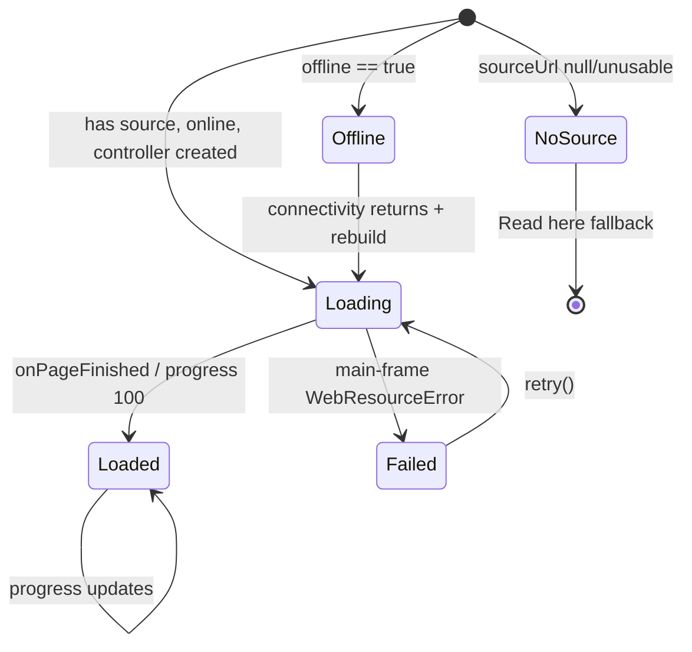

| UI | Condition |
|---|---|
| WebView | `hasSource && !offline.isOffline && !_failed` |
| Fallback card | no source / offline / failed |
| Retry | `_controller=null`, `_failed=false`, `_loading=true`, `_progress=0`, `_attempt++` |
| Back | WebView back if possible, else pop |

**Hazards**

- `_failed` is never cleared by a connectivity change; only the explicit retry
  clears it.
- `_attempt` remounts the WebView but does not clear JavaScript channels or
  previous load side effects.
- Progress is driven by injected JS; a page without the script leaves the
  progress bar at 0 until `onPageFinished`.

---

## 6. Ad impression/tap machine

**File:** `lib/core/widgets/tracked_ad_card.dart`.

**State holders:** widget lifetime only. Sold-unit check is
`AdUnit.isSold` (`placement != null`); tracker is fire-and-forget.

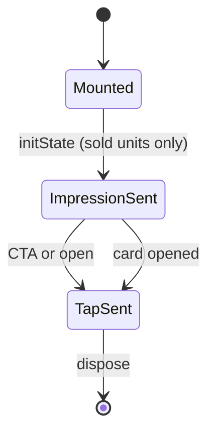

**Hazards**

- Impression is counted per `initState`, so any rebuild that recreates the card
  (list recycling without stable keys, `ValueKey(attempt)` changes) counts a new
  impression.
- Network failures are swallowed by `SponsorshipTracker`; there is no local
  pending queue or dedupe window.
- Opening via both CTA and card can produce two taps if callbacks overlap.

---

## 7. Offline-first article repository

**File:** `lib/core/data/repositories/offline_first_article_repository.dart`.

**State holders:** `_hydrated`, `_offline`, `_lastSyncedAt`,
`_inFlightRefresh`, cache freshness.

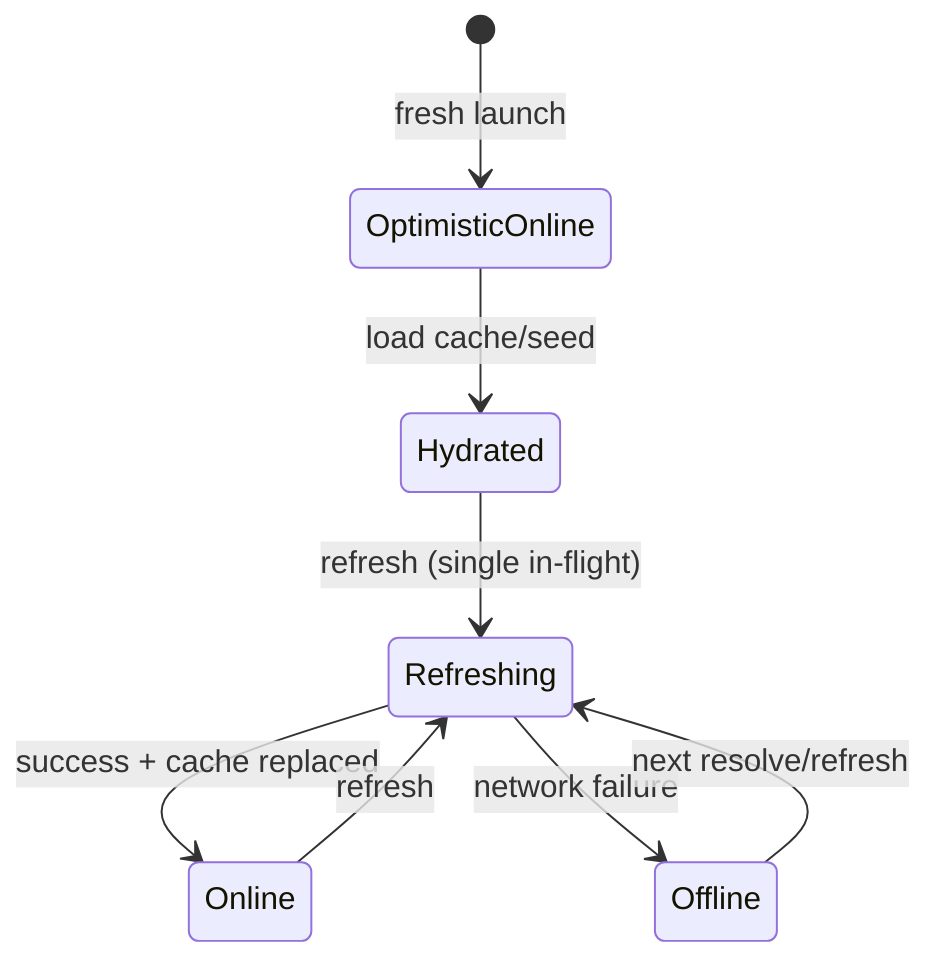

| Flag | Meaning |
|---|---|
| `_hydrated` | cache/seed read once |
| `_offline` | last refresh failed (not “connectivity state”) |
| `_inFlightRefresh` | coalesces concurrent refreshes |
| `_articleCacheIsFresh` | TTL decides cache vs network |

**Hazards**

- `_offline` is a remembered failure, not a live connectivity signal; one failed
  refresh flips the whole app banner until a later success.
- `_hydrated` is method-level guarded, not synchronized; concurrent calls rely
  on the same in-flight future.

---

## 8. Lazy league feed lifecycle (Sports tab)

**Files:** `lib/features/sports/presentation/sports_page.dart`
(`_leagueSections`), `widgets/sports_league_section.dart`,
`lib/core/providers/app_providers.dart` (`leagueNewsProvider`),
`league_news_source.dart`.

**State holders:** Sliver build/lifecycle, `AsyncValue<List<Article>>`,
in-memory `_cache` in `LeagueNewsSource`.

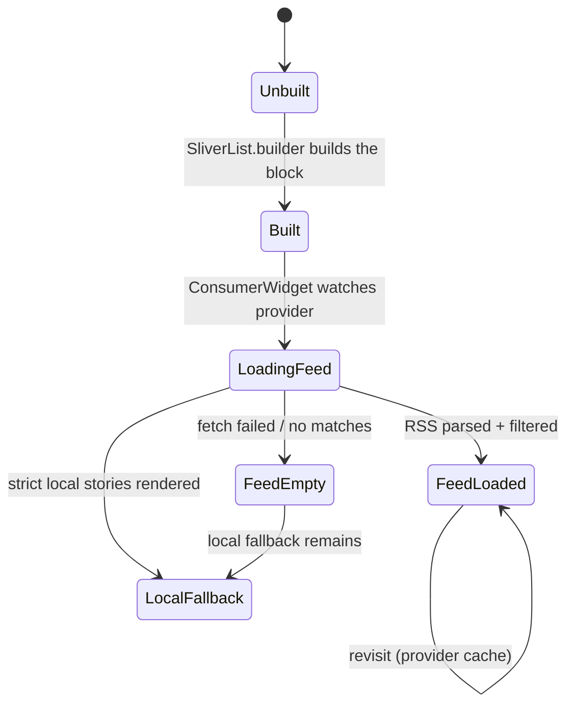

| State | What the user sees |
|---|---|
| Unbuilt | block not created; no request |
| LoadingFeed | score cards + strictly filtered local stories |
| FeedLoaded | league-specific RSS stories |
| FeedEmpty | score cards + local fallback (or nothing) |
| revisit | cached; no refetch |

**Hazards**

- Failure/empty is not distinguished in the UI; there is no retry and
  pull-to-refresh does not invalidate a cached successful feed.
- The strict local fallback can still be empty for a league with no matching
  story; the block becomes score-only.
- Feed requests are per built block; scrolling fast can create many concurrent
  requests.

---

## 9. Admin authentication gate (web)

**File:** `src/middleware.ts`; `src/lib/admin/sponsorship-auth.ts`;
`src/app/admin/sponsorships/actions.ts`.

**State holders:** `slnews_admin` cookie, derived token
`sha256("slnews-admin:<key>")`, login rate-limit bucket.

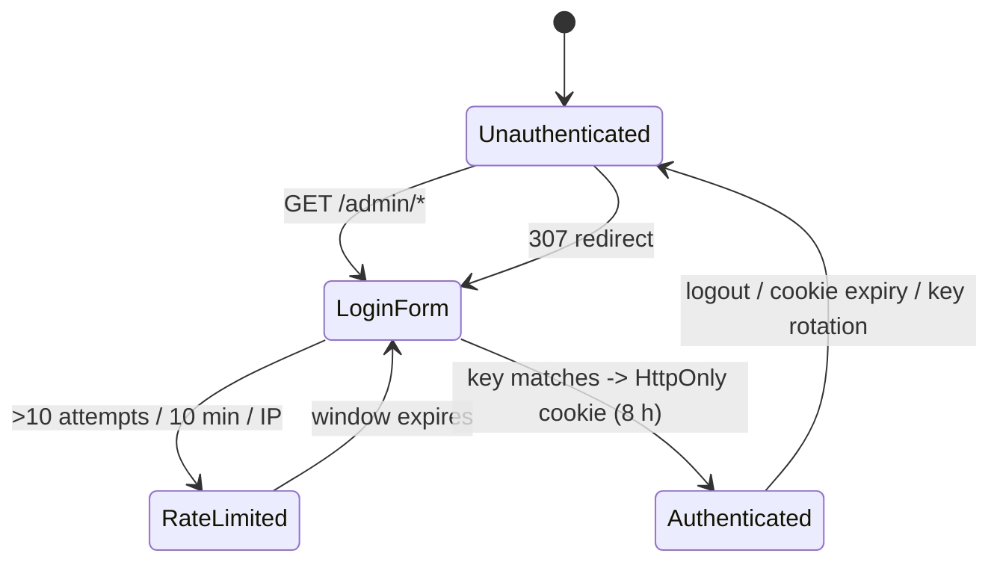

**Hazards**

- Cookie is a bearer equivalent: anyone who obtains it has full admin access;
  no roles, no device binding, no server-side revocation list.
- Key rotation invalidates cookies implicitly (derived token changes) but there
  is no audit log of admin actions.
- Login and admin pages are protected, but the API admin routes use a separate
  `x-admin-key` path with the same secret and no lockout beyond the comparison.

---

## 10. Sponsorship campaign lifecycle (web)

**Files:** `prisma/schema.prisma` (`Sponsorship`),
`src/app/api/mobile/v1/sponsorships/route.ts`, admin actions.

**State holders:** `active` boolean, `startsAt`, `endsAt`; effective state is
computed by the read query.

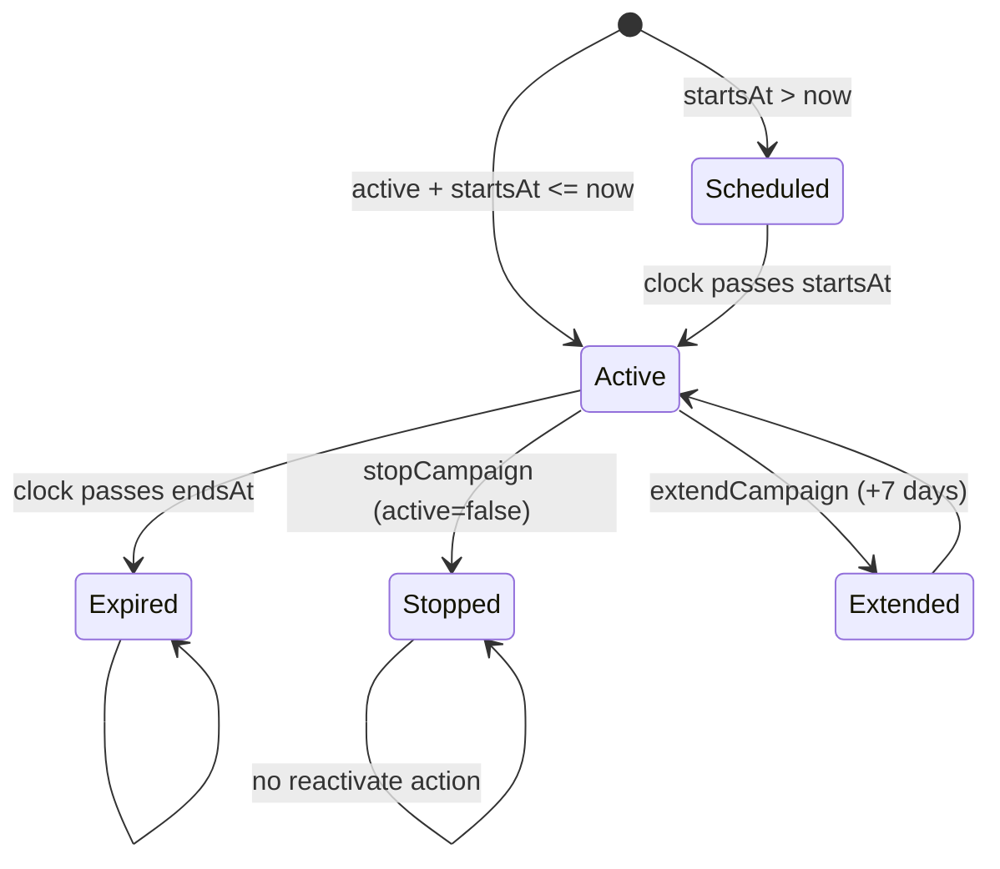

| Effective state | Query condition |
|---|---|
| scheduled | `startsAt > now` |
| active | `active && startsAt <= now && (endsAt null || endsAt >= now)` |
| expired | `endsAt < now` |
| stopped | `active = false` |

**Hazards**

- There is no explicit draft/paused/archived state; stop is irreversible from the
  console.
- Extending a campaign mutates `endsAt`; if the campaign is already expired it
  can re-enter the feed without an explicit “reactivate” event.
- App shows a max of 6 units (`MAX_ITEMS`) with no rotation/frequency cap, so the
  same creative can be served indefinitely.
- Only the `feed` placement is rendered by the app; `sports_stream` /
  `article_end` are selectable but unused.

---

## 11. Scraper image-backfill machine

**Files:** `src/services/image-metrics.ts`, `src/services/scraper.ts`
(`backfillImages`), `src/services/runtime-state.ts`.

**State holders:** persisted `runtime_state.image_backfill`
(`missing_remaining`, `stuck_runs`, `alert`, `limits.reason`) + env overrides.

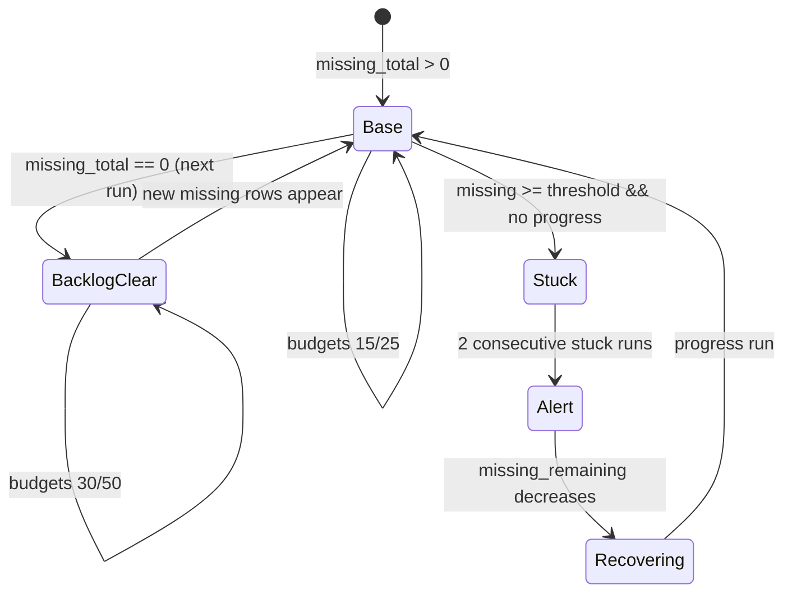

| Rule | Value/source |
|---|---|
| base budgets | 15 missing / 25 revalidate |
| backlog-clear budgets | 30 / 50 |
| alert threshold | 50 (env override) |
| alert after | 2 stuck runs |
| persistence | `runtime_state` (separate cron process) |

**Hazards**

- `alert` and `stuck_runs` are persisted but there is no acknowledgement/reset
  action; the same alert remains until progress occurs.
- No per-run dead-letter list for URLs that repeatedly fail; they stay in the
  missing count and can keep the alert on.
- Env overrides bypass the adaptive reason (`reason: 'env'`), so the budget mode
  reported in `/api/stats` can disagree with the effective intent.

---

## 12. Minor UI lifecycle states (not full machines)

| Component | Implicit state | Risk |
|---|---|---|
| `SlPageScaffold` | `_showScrollToTop` from scroll offset | harmless |
| `FadeSlideIn` | `_visible`, `_reduced` | animation replay on rebuild |
| `PressableInkWell` | `_pressed` | pointer cancel/leave |
| `SkeletonBox` | animation controller | test timers pending |
| `NewsPage` host | selected category + tab controller | index drift after data reload |
| `VideoReelPage` | page index + controller lifecycle + web player | late callbacks after dispose |

---

## Highest-risk implicit combinations

1. **Anonymous shell flash** before auth restore (`unknown` treated as signed
   out) and anonymous users skipping personalisation entirely.
2. **Partial onboarding** if a follow/location write throws after some writes.
3. **Desired-vs-applied FCM topics** with swallowed errors and no persisted
   applied set.
4. **Sync failure has no retry**; the UI can sit in `failed` until another local
   mutation.
5. **Offline flag is sticky** after one failed refresh and gates the WebView.
6. **Ad impressions counted per mount**, with no dedupe window.
7. **Lazy league feed has no failure state/retry** and pull-to-refresh cannot
   clear a cached feed.
8. **Campaign stop is irreversible**; expiry can be undone by extension.
9. **Scraper alert has no ack** and repeatedly failing URLs can hold it open.

---

## Suggested refactors (incremental)

1. Replace boolean clusters with **sealed state classes**:
   `AuthGateState`, `OnboardingState`, `PushSyncState`, `ReaderState`,
   `LeagueFeedState`. Make transitions explicit methods and add statechart
   tests (allowed/forbidden transitions).
2. Persist **applied** push topics and sync schema version; reconcile at
   startup with exponential backoff.
3. Give lazy league feeds an explicit `loading | ready | empty | error` state
   with retry, and have pull-to-refresh invalidate them.
4. Add a real campaign enum (`draft/scheduled/active/paused/expired/stopped`)
   and an explicit reactivate event; stop should be reversible.
5. Add an image-backfill dead-letter table and an alert acknowledgement.
6. Add ad impression idempotency (unit id + 24 h device window) and count
   only after viewability.

---

### Source index

| Machine | Primary source |
|---|---|
| Session gate | `app_shell.dart`, `auth_providers.dart` |
| Onboarding | `onboarding_page.dart`, `SettingsController` |
| Push topics | `push_service.dart`, `SettingsController`, `FollowingController` |
| Sync | `sync_controller.dart`, `sync_repository.dart` |
| WebView reader | `article_web_page.dart` |
| Ad tracking | `tracked_ad_card.dart`, `sponsorship_tracker.dart` |
| Offline cache | `offline_first_article_repository.dart` |
| Lazy league feeds | `sports_page.dart`, `sports_league_section.dart`, `league_news_source.dart` |
| Admin auth | `middleware.ts`, `sponsorship-auth.ts` |
| Campaign lifecycle | `schema.prisma`, sponsorships route/actions |
| Backfill | `image-metrics.ts`, `scraper.ts` |
